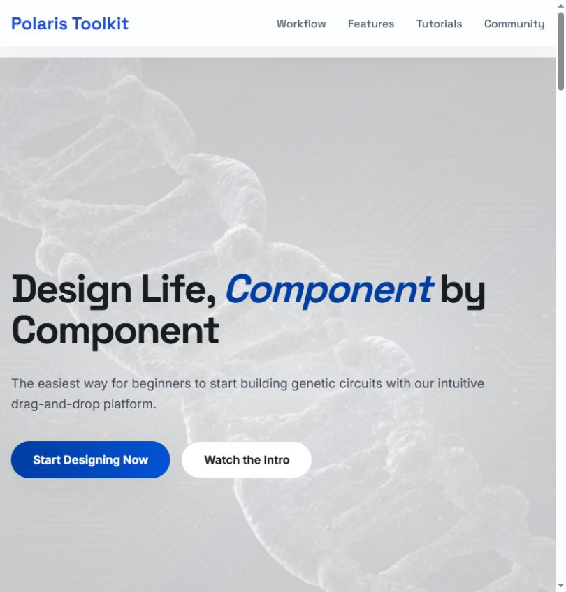
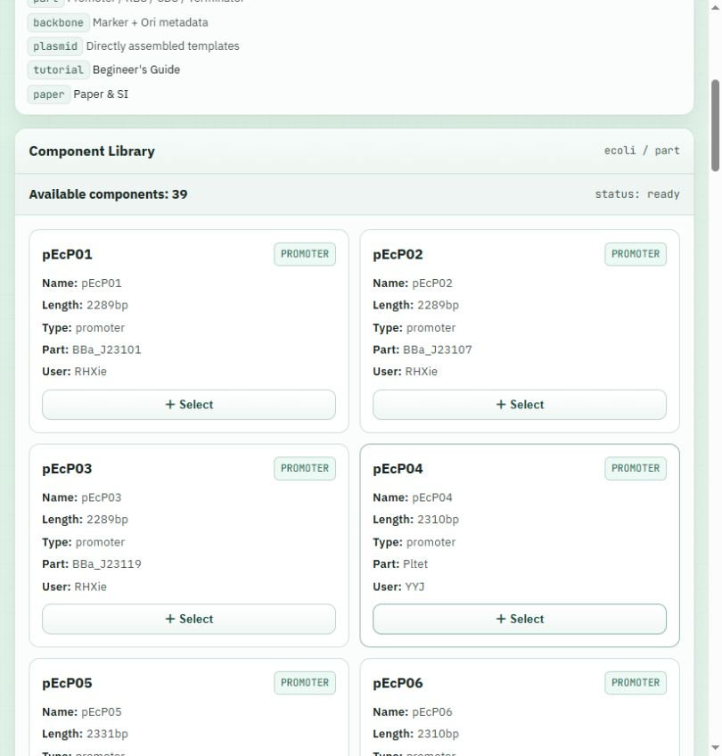
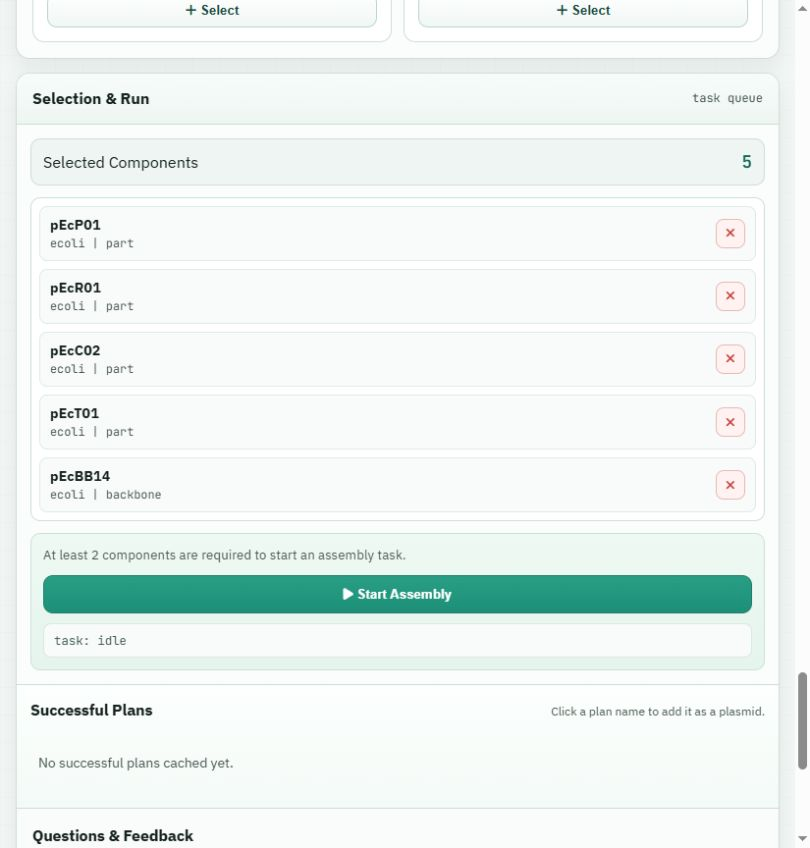
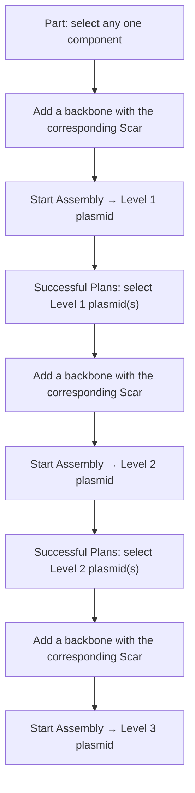

# Polaris Kit Assembly

*A gene circuit automated design platform based on a component database.*
 


---

## Overview

**Polaris Kit Assembly** is a comprehensive platform that enables synthetic biology researchers and beginners to design genetic circuits in a few clicks. It consists of two core Django sub‑projects:

- **WebDataBase** – provides database APIs and business‑logic APIs for the entire platform.
- **KitAssembly** – delivers a user‑friendly web service that allows beginners to select biological parts (components, vectors, plasmids) and assemble them into gene circuits and download the results as GenBank files.

---

## Sub‑Projects

### WebDataBase
`WebDataBase` is a Django‑based backend service that:
- Manages the component database (parts, vectors, plasmids, and their metadata).
- Exposes RESTful APIs for querying, filtering, and retrieving component information.
- Implements core business logic (e.g., assembly rules, compatibility checks) used by the frontend and the KitAssembly service.

### KitAssembly
`KitAssembly` is the end‑user web application, also built with Django. It is designed for **synthetic biology beginners** who want to design gene circuits without prior programming or bioinformatics expertise.

#### Key features:
- **Part Selection** – Browse and select one or more genetic components (promoters, CDSs, terminators, etc.) from the database.
- **Vector & Plasmid Selection** – Choose a compatible vector backbone for your assembly.
- **One‑Click Assembly** – Once parts and a vector are selected, the backend validates compatibility and assembles the circuit.
- **GenBank Output** – Download the assembled construct as a GenBank (`.gb`) file and inspect its map and annotations in a compatible sequence viewer.

---

## Getting Started

### Prerequisites

- Python 3.10+ and pip; the dependency files currently target Django 5.2.
- MySQL 8.0 for the WebDataBase backend and bundled SQL export. The KitAssembly frontend uses SQLite, provided by Python.
- Git and a MySQL account with access to the intended database.

The commands below use **Windows PowerShell**. On Linux/macOS, use `.venv/bin/python` instead of `.venv/Scripts/python.exe` and the equivalent shell copy commands. Dependency files list runtime requirements; they are not fully validated, pinned lockfiles.

### Installation

1. **Clone the repository and install dependencies.** Run from the directory where you want the checkout:

   ```powershell
   git clone https://github.com/ChenYe-Lab/PolarisKitAssembly.git
   cd PolarisKitAssembly
   python -m venv .venv
   ./.venv/Scripts/python.exe -m pip install -r WebDataBase/requirements.txt -r KitAssembly/requirements.txt
   ```

2. **Create each service's configuration.** From the repository root, copy the examples only if the corresponding `.env` does not exist:

   ```powershell
   if (-not (Test-Path WebDataBase/.env)) { Copy-Item WebDataBase/.env.example WebDataBase/.env }
   if (-not (Test-Path KitAssembly/kitapp/.env)) { Copy-Item KitAssembly/kitapp/.env.example KitAssembly/kitapp/.env }
   ```

   Edit both files before starting either service. Replace the secret-key placeholders with separately generated random keys; preserve existing deployment credentials. The local setup uses backend port **8000** and frontend port **8001**:

   | File | Required local configuration |
   | --- | --- |
   | `WebDataBase/.env` | `DJANGO_SECRET_KEY`; `DB_NAME`, `DB_USER`, `DB_PASSWORD`, `DB_HOST`, `DB_PORT`; `DJANGO_DEBUG=True`; `WEBDATABASE_API_BASE_URL=http://127.0.0.1:8000/WebDatabase/` |
   | `KitAssembly/kitapp/.env` | `SECRET_KEY`; `DEBUG=True`; `WEBDATABASE_URL=http://127.0.0.1:8000/WebDatabase/`; `LABDATABASE_URL=http://127.0.0.1:8000/LabDatabase/` |

   For API-backed catalog and assembly operations, also configure the frontend's `API_LOGIN_USERNAME` and `API_LOGIN_PASSWORD` with a valid backend account. `API_LOGIN_URL` defaults to the WebDatabase base URL followed by `login`. Starting the frontend alone does not populate the catalog or establish API access.

3. **Initialize the backend schema in a new empty database.** Create an empty MySQL database with `utf8mb4` encoding and set the backend's `DB_NAME` to that database. Then, from the repository root:

   ```powershell
   cd WebDataBase
   ../.venv/Scripts/python.exe manage.py migrate --plan
   ../.venv/Scripts/python.exe manage.py migrate
   ../.venv/Scripts/python.exe manage.py makemigrations --check --dry-run
   cd ..
   ```

   `manage.py` automatically selects `WebDataWorld.settings`. Migrations create the Django-managed schema but do not load component data or create tables declared `managed=False`. For an existing database, especially one that recorded the old empty initial migration, follow [Database migrations](WebDataBase/MIGRATIONS.md) before attempting an upgrade. Replacing a migration file does not rerun a migration already marked as applied.

4. **Initialize the frontend's SQLite database.** From the repository root:

   ```powershell
   cd KitAssembly/kitapp
   ../../.venv/Scripts/python.exe manage.py migrate
   cd ../..
   ```

   This `manage.py` selects `kitapp.settings`. Its default SQLite file is `KitAssembly/kitapp/db.sqlite3`; `SQLITE_PATH` can override it. Keep existing databases when updating a deployment.

### Importing the Bundled Catalog SQL

The repository includes `KitAssembly_Labdnadata_20260923_072954.sql`, a **MySQL 8 catalog subset containing both schema and data**. It is not a Django fixture or a full deployment backup.

After migrating a **new database with empty catalog tables**, run from the repository root:

```powershell
cd WebDataBase
../.venv/Scripts/python.exe manage.py import_kit_catalog ../KitAssembly_Labdnadata_20260923_072954.sql --dry-run
../.venv/Scripts/python.exe manage.py import_kit_catalog ../KitAssembly_Labdnadata_20260923_072954.sql
../.venv/Scripts/python.exe manage.py create_kit_service_user kit-service
cd ..
```

The account command prompts for a password without echoing it. Set the frontend's
`API_LOGIN_USERNAME=kit-service` and `API_LOGIN_PASSWORD` to this password. The account
has the `editor` role for service writes, without Django admin privileges. Ordinary
`user` accounts can read the catalog but cannot perform business writes.

The importer reads literal values from 20 allowlisted catalog tables and preserves
IDs and relationships; it never executes the dump's schema statements. It imports
2,507 rows and skips 8 historical task/result rows. Legacy NULL feature grouping
labels become empty strings. Dry runs insert within a transaction and roll back;
nonempty target catalogs are refused, and failures roll back all imported rows.
The snapshot does not contain the requested backbones `pEcBB38`, `pEcBB39`, `pEcBB40`
and `pScbb33`; importing cannot recreate missing records. See
[database guidance](WebDataBase/MIGRATIONS.md#bundled-kitassembly-sql).

Do not run MySQL `SOURCE` directly against the Django-migrated database. Existing
installations require a separate migration plan; this command does not merge or
overwrite existing catalogs.

### Running the Local Servers

Open **two terminals**, each starting in the repository root.

Backend API, terminal 1:

```powershell
cd WebDataBase
../.venv/Scripts/python.exe manage.py runserver 127.0.0.1:8000
```

Frontend website, terminal 2:

```powershell
cd KitAssembly/kitapp
../../.venv/Scripts/python.exe manage.py runserver 127.0.0.1:8001
```

Open `http://127.0.0.1:8001/`. If you change the backend address or port, update the API URLs in both services' `.env` files. Neither command should be run with the nonexistent `WebDataBase.settings` or `KitAssembly.settings` modules.

`runserver` is for local development. Production requires a suitable WSGI/ASGI server, static/media serving, HTTPS, and explicit host/CSRF settings. Set `DJANGO_DEBUG=False` for the backend and `DEBUG=False` for the frontend, and review secure-cookie settings and task/cache behavior for your process layout using the configuration documents below.

### Regression Tests

Run from the repository root after installing both requirement files:

```powershell
cd WebDataBase
../.venv/Scripts/python.exe tests/test_migrations.py -v
../.venv/Scripts/python.exe manage.py test WebDatabase.tests LabDatabase.tests --settings=WebDataWorld.test_settings
cd ../KitAssembly/kitapp
../../.venv/Scripts/python.exe manage.py test kitserver --settings=kitapp.test_settings
cd ../..
node --test tests/html_rendering.test.cjs
```

Python tests use isolated databases; real backend HTTP login is exercised on a local
test server. Node.js 20+ runs the HTML rendering checks. GitHub Actions runs the
backend suite against SQLite and a disposable MySQL 8 service, plus frontend and
migration tests. Keep test source files and migrations in Git. Local databases,
logs, bytecode and collected static files are ignored. Before production static
serving, run `manage.py collectstatic --noinput` separately in each service.


---

## Configuration

Each service reads its own `.env`; process environment variables take precedence. There is no shared root `.env.example` or root `manage.py`.

- Backend: [configuration guide](WebDataBase/CONFIGURATION.md), [environment example](WebDataBase/.env.example), and [database migration guide](WebDataBase/MIGRATIONS.md).
- Frontend: [configuration guide](KitAssembly/kitapp/CONFIGURATION.md) and [environment example](KitAssembly/kitapp/.env.example).

Keep secrets out of version control. Configure optional tutorial and ZIP file paths in the frontend when those downloads are needed.

---

## Usage Example

The screenshots below show the local KitAssembly website. Open the address and port configured for your frontend (for example, `http://localhost:8001/`); the backend API may use a different port. Component availability depends on your database.

1. **Open the builder.** On the homepage, click **Start Designing Now** to open `/kitserver/index`. If **Visitor Registration** appears on your first visit, enter your institution, lab/group, and name, then choose **Save And Continue**. Use **EN** or **中文** to switch the interface language.

   

2. **Browse and select components.** Choose **E.coli** or **S. cerevisiae**, then switch between **Part**, **Backbone**, and **Plasmid**. Review each card's metadata and click **Select** to add it; selected cards display **Selected**.

   

3. **Review the assembly plan.** Check **Selection & Run** (below the library on narrow screens). Use the remove button beside an entry to correct the selection. Follow the Level 1–3 workflow below to choose the inputs for each round. The screenshot demonstrates the selection controls only; its five-item selection is not the Level 1 recipe or a validated assembly result.

   

4. **Submit and download.** With at least two components selected, click **Start Assembly** and watch the task status. When the task completes, dismiss the success message to let the browser download the GenBank (`.gb`) file. Successful plan names appear in **Successful Plans** and can be added as plasmids for a later assembly. If the task fails, review the reported error and revise the selection. Open the downloaded GenBank file in a compatible sequence viewer to inspect the plasmid map and annotations.

### Level 1–3 Assembly Workflow

Build each level from the successful results of the previous level. Before starting a new round, remove the previous inputs from **Selection & Run** so that only the intended parts/plasmids and backbone remain selected.



1. **Level 1 — one part + a matching backbone.** In **Part**, select any **one** component. Switch to **Backbone** and select the backbone with the corresponding **Scar** for that component. Review the two selected inputs and click **Start Assembly**. After a successful run, download the Level 1 GenBank file; its plan name is available in **Successful Plans**. Repeat this step for each Level 1 plasmid needed in the next round.

2. **Level 2 — Level 1 plasmids + a matching backbone.** In **Successful Plans**, click the required **Level 1** plan names to add those assembly results as plasmid inputs. In **Backbone**, select the backbone with the corresponding **Scar** for this assembly. Review the selected plasmids and backbone, then click **Start Assembly** to generate the Level 2 plasmid. The successful Level 2 result is also listed in **Successful Plans**.

3. **Level 3 — Level 2 plasmids + a matching backbone.** Follow the same procedure as Level 2, but select the **Level 2 assembly results** from **Successful Plans**. Add the backbone with the corresponding **Scar**, review the inputs, and click **Start Assembly** to generate and download the Level 3 plasmid.

Check the backbone card's **Scar (bbsi)** / **Scar (bsai)** information for the relevant assembly step. For assembly-level details and example plasmid maps, see the [assembly tutorial](KitAssembly/docs/kitassembly/quickstart.md).

---

## Technologies

- **Django** & **Django REST Framework** – Backend APIs and web UI.
- **MySQL** – Backend component and application database.
- **SQLite** – Frontend Django database.
- **Python threading** – Background assembly execution in the backend.
- **BioPython** – For sequence manipulation and validation.
- **Matplotlib** – Plotting and diagram support.

---

## Contributing

Contributions are welcome! Please open an issue or submit a pull request with your improvements. Make sure to follow the coding style and include appropriate tests.


---

## License

This project is licensed under the **GNU General Public License v3.0** – see the [LICENSE](LICENSE) file for details.

---

## Contact

For database-related inquiries, please contact [synbio.db@siat.ac.cn](mailto:synbio.db@siat.ac.cn).
